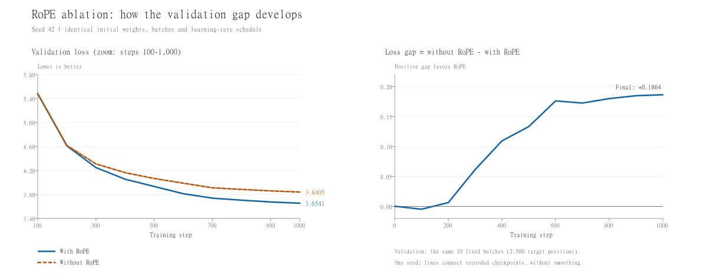
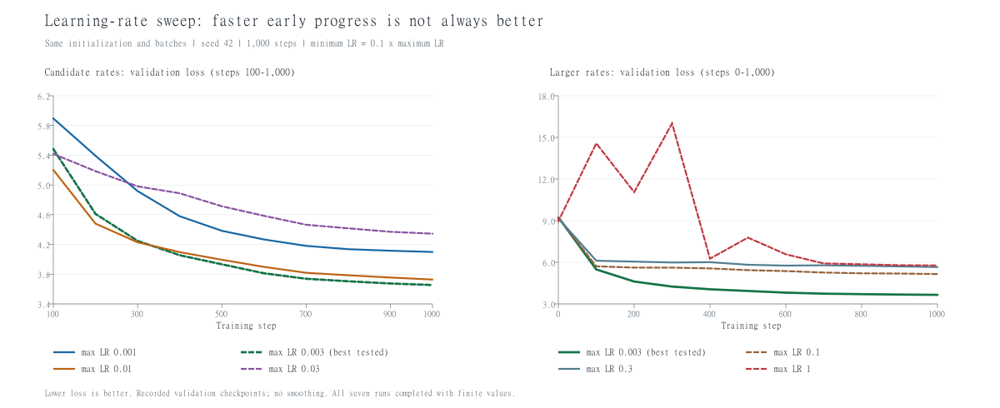

# 2026-10-27｜A1：训练与生成闭环、RoPE 消融及学习率扫描

> 学习内容按 2026-10-27 归档；整理与 GitHub 同步跨至 2026-10-28 凌晨。

## 本次完成范围

在[当天较早的优化器与单批次实验](2026-10-27-A1-TRAINING-AND-CHECKPOINT.md)之后，完成随机批次训练、固定验证批次评估、训练时学习率调度、存档恢复、文本生成，以及 5 MB 样本上的小模型实验。

随后完成 RoPE/NoPE 三个随机种子的配对对照，以及七个学习率尺度的单种子扫描。代码、配置、CSV 与图均已归档；不提交原始语料、分词器 pickle、token 数组、模型存档或上游测试。

这是样本规模的学习实验，不表示 A1 全部交付完成，也没有达到正式完整数据训练的要求。

## 逐文件说明

以下文件均位于[源码归档](../implementations/a1-basics/cs336_basics/)，活动运行目录仍为 `assignments/a1-basics/cs336_basics/`。

| 文件 | 今天新增的内容 | 运行方式或边界 |
| --- | --- | --- |
| `train_loop.py` | 将 892 个 token 按位置划为 713/179；每步随机抽训练批次；10 个固定验证批次取平均；接入 warmup/cosine、裁剪与存档恢复 | CPU，B=2、T=16；两次运行各完成 50 步；已完成后再次运行会退出 |
| `generate_demo.py` | 加载小样本存档；提示词编码；读取末位置 logits；温度、top-p、采样、EOS 停止与上下文截取 | B=1，T=16；最多生成 40 个新 token；生成不更新模型参数 |
| `prepare_5m_tokens.py` | 加载原有 10k 分词器，在约 90% 处的故事结束标记后划分文本，分别编码、检查还原并保存数组 | 不重新训练 BPE；使用 uint16，先检查 ID 范围 |
| `train_5m.py` | 读取两个独立数组；B=4、T=64；总计划 1000 步、预热 50 步；使用独立存档 | 当前每次最多运行 900 步；历史先运行 100 步、再恢复 900 步 |
| `generate_5m.py` | 加载 5 MB 实验的模型存档，使用相同分词器及 T=64；支持最多 120 个新 token | 仅保留最近 64 个 token 作为每步模型输入；完整生成结果仍保留 |
| `train_rope_ablation.py` | 从头训练有/无 RoPE 两组，各 1000 步；固定验证集；核对初始参数和训练批次哈希；保存曲线、配置与存档 | 无 RoPE 通过将各层 `attn.rope` 设为 None 实现；因果遮罩保持存在 |
| `run_rope_multiseed.py` | 复用种子 42，补跑种子 43、44；校验配置和曲线后汇总配对差值、均值与样本标准差 | 同一种子内部严格配对；跨种子改变初始化及训练抽样顺序，验证批次保持固定 |
| `train_lr_sweep.py` | 固定全部 1000 个训练批次；复用 0.003 基线；扫描 0.001 至 1.0；检测非有限 loss/梯度，保存过程记录 | 比较整条学习率曲线的尺度；每组最低值为最高值的 0.1 倍 |

同步时仅修正 `train_5m.py` 中过时的步数注释，以及 `generate_5m.py` 中仍写 16 的上下文注释；没有改变计算逻辑。累计快照包含 38 个活动源码模块，逐文件 SHA-256 见[源码清单](../implementations/a1-basics/SOURCE_MANIFEST.json)。

## 从固定批次拟合到验证集评估

先保留原来的 `train_demo.py` 作为链路检查，再独立建立训练/验证循环。

| 阶段 | 第 100 步验证 loss | 说明 |
| --- | ---: | --- |
| 一个固定验证批次、固定学习率 | 5.4880 | 只覆盖 32 个目标位置 |
| 十个固定验证批次、固定学习率 | 6.5927 | 验证材料扩大，提前抽验证批次也改变了后续训练抽样顺序，不能直接与上一行判断优劣 |
| 十个固定验证批次、加入调度 | 6.9708 | 同一扩展验证设置下，本次 100 步结果不如固定学习率；调度不保证自动改善效果 |
| 加入恢复流程，完成 50+50 步 | 6.9993 | 成功从第 51 步继续，学习率接上原进度；不保存 RNG，抽样序列不等同于一次连续运行 |

训练 loss 是当前随机批次、更新参数之前的值；验证 loss 是更新后在固定批次上计算的平均值。训练批次变化本身会带来 loss 波动。验证批次固定时，验证 loss 上升表示模型对这组材料的预测暂时变差。

`model.eval()` 切换运行模式；`torch.no_grad()` 关闭梯度记录。验证与生成都没有执行优化器更新。当前网络没有 dropout 等依赖模式的层，两者仍按规范调用。

## 5 MB 数据准备与首轮训练

使用官方 fixture `tinystories_sample_5M.txt`。沿接近 90% 的位置寻找下一处 `<|endoftext|>`，在结束标记后切分；避免把一篇故事拦腰切到两边，但没有执行跨文档去重。

| 项目 | 训练集 | 验证集 |
| --- | ---: | ---: |
| 故事结束标记数 | 5812 | 645 |
| token 数 | 1,143,921 | 127,340 |
| 数组占用 | 2.18 MiB | 0.24 MiB |
| 编码与还原检查耗时（用户回执） | 32.84 秒 | 3.70 秒 |
| 完整还原 | True | True |

继续使用在同一 5 MB 文本上训练的 10k BPE。上述验证文本没有用于 LM 梯度更新，但词表曾见过整份样本文本；这不是完全独立的端到端验证数据集。

模型配置：词表 10000，d_model=64，2 层，4 头，SwiGLU d_ff=128，RoPE theta=10000，Embedding 与输出权重独立，约 136 万参数。CPU 4 线程，B=4、T=64，AdamW 默认 betas=(0.9,0.999)、eps=1e-8，weight_decay=0.01，梯度裁剪 1.0，最大学习率 0.003、最低 0.0003，50 步预热，总训练 1000 步。

用户先运行 100 步，再恢复完成 900 步：

| 进度 | 平均验证 loss |
| --- | ---: |
| 随机初始化 | 9.2128 |
| 100 步 | 5.4672 |
| 940 步 | 3.6357 |
| 1000 步 | 3.6202 |

每步处理 256 个目标位置，1000 步合计 256,000 个位置；随机采样可能重复，不代表遍历了整个训练集。这轮恢复没有保存 RNG，不能直接替代下面从头连续训练的 RoPE 对照基线。

## 生成：从重复标点到局部通顺

先用贪心解码观察到连续逗号，再加入随机采样、温度和 top-p。生成流程：提示词编码 → 模型前向 → 取末位置 logits → 除以温度 → softmax → 按概率排序 → 保留累计概率达到阈值所需的候选 → 重新归一化 → 抽样 → 接回输入。

跨过 top-p 阈值的 token 也保留。抽样得到排序位置后，需要映射回真正的词表 ID。遇到 EOS 停止；否则最多生成指定数量的新 token。每次输入截取最近 context_length 个位置。

用户用 1000 步 5 MB 模型得到的历史样例，temperature=0.8、top_p=0.9、最多 120 个新 token：

```text
Once upon a time, there was a little boy named Tim. He did not know what to do. They were so much fun.
Tim and her mom looked at the dog, and a warm ball named Mia. He had a big rock in the park. He did not know what to the ball. He gave the yummy to go inside her beak.
She saw a hug and her mom didn't know what Tom. They were sad.
```

样例说明模型学到常见句式，但指代、人物与事件连贯性仍不稳定；部分句子语法或用词不完整。64-token 窗口可能影响远处信息的使用，不能把所有错误归因于窗口。验证 loss 衡量目标 token 概率，不直接衡量故事质量。

采样脚本未显式固定采样 RNG；上述文本来自用户一次运行回执，不保证逐字复现。正式生成题要求的至少 256 token（或到 EOS）样例仍未补齐。

## RoPE 消融：三种子配对比较

每个版本从头训练 1000 步。RoPE 无可训练参数，因此关闭它不改变参数数量或初始参数。保留因果遮罩；不把 NoPE 解释为模型完全无法利用任何顺序信息。

每个种子内部核对初始参数与实际输入批次哈希。三个种子共享 validation_seed=12345 生成的 10 个固定验证批次，共 2560 个目标位置，片段可能重叠。

| 种子 | 有 RoPE | 无 RoPE | 无 − 有 |
| --- | ---: | ---: | ---: |
| 42 | 3.6541 | 3.8405 | +0.1864 |
| 43 | 3.6976 | 3.8353 | +0.1377 |
| 44 | 3.6466 | 3.8413 | +0.1947 |

配对差值平均 **+0.1729**，样本标准差 **0.0308**。三次方向一致，支持当前模型、训练预算和固定验证材料下 RoPE 有收益；样本标准差描述这三个种子的波动，不是置信区间，也不是准确率变化。



种子 42 在第 100 步几乎重合，无 RoPE 略低 0.0046；到第 300 步，有 RoPE 的优势达到约 0.0615；第 600 步约 0.1761，之后小幅波动，最终 0.1864。曲线说明优势在训练中逐渐显现，不能单凭这张图断言具体改善了哪些语言能力。

[三种子结果表](experiments/2026-10-27/rope/multi_seed_results.csv) · [完整实验数据导航](experiments/2026-10-27/README.md)

## 学习率扫描：早期快不代表最终好

固定 RoPE 模型、seed=42、相同初始参数和全部 1000 个训练批次。复用配置、权重哈希、数据顺序哈希及初始验证 loss 均核对一致的 0.003 基线。只改变学习率曲线的整体尺度：每组 min_lr=0.1×max_lr，预热和总步数相同。

起始搜索 0.001、0.003、0.01、0.03，全部完成后扩展到 0.1、0.3、1.0。新增六组训练各完成 1000 步；额外的梯度平方和检查不修改梯度，供非有限数值检测使用。

| 最大学习率 | 最低学习率 | 最终验证 loss | 状态 |
| --- | --- | ---: | --- |
| 0.001 | 0.0001 | 4.0989 | 完成 |
| **0.003** | **0.0003** | **3.6541** | 复用已有完整基线 |
| 0.01 | 0.001 | 3.7276 | 完成 |
| 0.03 | 0.003 | 4.3451 | 完成 |
| 0.1 | 0.01 | 5.1529 | 完成 |
| 0.3 | 0.03 | 5.6569 | 完成 |
| 1.0 | 0.1 | 5.7733 | 完成，有明显波动 |



0.01 在前约 300 步更快，约第 400 步后被 0.003 反超。1.0 的验证 loss 在第 100 步约 14.57，第 300 步约 16.01，第 400 步回落到约 6.26；训练 loss 的逐步峰值约 84.54。所有正式组都完成训练，没有出现非有限 loss 或梯度，因此不能将波动、效果恶化写成已经观察到数值发散。

结论限于当前候选、模型、1000 步预算和种子 42：0.003 最好，后续先沿用。它不是所有配置的全局最优；正式学习率题的发散边界分析尚未完成。

[学习率结果表](experiments/2026-10-27/lr/learning_rate_results.csv) · [学习率配置与结果](experiments/2026-10-27/lr/lr_sweep_summary.json)

## 验证与同步证据

- 实际跑完 RoPE 六组配对训练；三组初始化和批次配对检查均通过，跨种子指纹不同。核对 CSV 最终步数、结果汇总和存档存在。
- 学习率七个候选均有 1000 步曲线和存档；一组复用、六组新增；初始化与实际训练批次哈希一致，CSV 和汇总数值一致。
- 新脚本先做两步小检查，核验存档与 CSV；非有限 loss 的停止分支用人工注入 NaN 验证。该人工检查不属于正式实验，不用于声称任何学习率真实发散。
- 源码快照 38 个模块逐字节核对，40 个 Python 文件语法检查通过；直接导入归档包及提取接入函数，模型/训练支持组合测试 **20 passed，10.13s**。有一条 jaxtyping 被检查脚本预先导入产生的重写警告，无测试失败；这不是 A1 全套测试。
- CSV 来自实际运行记录；JSON 导出保留配置、指标和哈希，将机器绝对路径改成相对路径或未上传存档的文件名。图为记录点直线连接，没有平滑；原始/导出文件哈希见[实验来源清单](experiments/2026-10-27/SOURCE_MANIFEST.json)。

## 下一步与未完成项

1. 批次大小对比，先明确比较固定更新步数还是固定处理 token 数，避免混淆预算。
2. 其余结构实验：移除 RMSNorm、post-norm、普通 SiLU 前馈；SiLU 版需考虑与 SwiGLU 的参数数量匹配。
3. 学习率数值发散边界、更多验证材料和必要的重复实验。
4. 参数量、FLOPs、AdamW 显存与计算核算；完整语料上的 BPE/Tokenizer 与 OWT 对比。
5. 更完整的训练配置入口、RNG/采样状态恢复、可复现采样、正式生成样例及 writeup。

本地讲义第 40 页给出的 CPU/MPS 低资源建议约处理 4000 万 token；本次每组仅 25.6 万，模型和数据也更小。当前结果用于学习与对照，不与正式目标直接比较。Tokenizer 任意切块边界和 Linux 内存约束仍未完成验证，课程讲次勾选也不依据实现进度自动改变。
