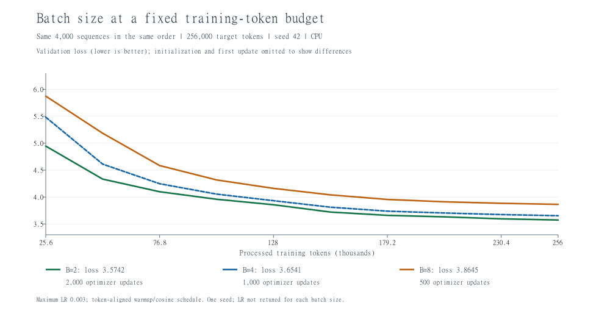

# 2026-10-29：A1 批次大小对比

## 要回答的问题

每次更新使用多少段文本，会怎样影响相同训练 token 预算下的验证 loss 和耗时？

每段长度 64。先抽取同样的 4000 段输入及其下一 token 目标，再按原顺序分别每 2、4、8 段组成批次。每组都处理 256,000 个目标 token；这是抽样窗口中的目标位置数，窗口可能重复或重叠，不是独立语料 token 数。

| batch size | 每次更新的目标 token | 更新次数 | 最终验证 loss | 训练计算耗时 |
| --- | ---: | ---: | ---: | ---: |
| 2 | 128 | 2000 | 3.574226 | 59.70 秒 |
| 4 | 256 | 1000 | 3.654119 | 42.74 秒 |
| 8 | 512 | 500 | 3.864518 | 33.82 秒 |

训练计算耗时包含学习率设置、清梯度、前向、反向、裁剪、优化器更新；不含验证、文本指纹检查和存档写入。CPU 单次顺序运行结果会受系统负载影响，不属于严格性能基准。

横轴是已处理 token 数，三组检查点按相同 token 进度对齐。图省略初始和首次更新点，从 25,600 token 开始；完整 CSV 保留全部记录。点之间直接连线，无平滑。

## 保持一致的内容

- 模型：词表 10,000、上下文 64、维度 64、2 层、4 个注意力头、SwiGLU 中间维度 128、RoPE。
- 初始参数 seed=42；4000 段训练文本及顺序完全一致，只改变分组。
- 验证使用原来的固定 10 批，每批 4 段，抽样 seed=12345，不随训练批次大小改变。
- AdamW：betas=(0.9,0.999)、eps=1e-8、weight_decay=0.01；梯度裁剪阈值 1。
- 学习率最大 0.003、最低 0.0003；前 12,800 token 预热，到第 256,000 token 结束余弦下降。每次更新按该批结束时的 token 进度取值，共同记录点的学习率一致。
- CPU，PyTorch 2.11.0+cpu，4 个计算线程。

## 怎样理解结果

当前条件下，batch=2 最终验证 loss 最低，但训练计算耗时最长；batch=8 用时最短，最终 loss 较高。

例如同样 8 段文本：batch=2 会更新 4 次，后面的文本用已经更新过的参数计算；batch=8 会把 8 段都用于一次更新。因此，同样的例子并不意味着同样的优化过程。

小批次通常有更大的梯度噪声，大批次的平均梯度通常更平稳；本次没有直接测量梯度方差，不能把效果差异完全归因于噪声。更新次数、AdamW 的动量和每步权重衰减累积也随之变化。

这里只比较一个种子、三个批次大小和同一学习率设置，尚未分别调优学习率；结论不能推广为小批次总是更好。固定 token 数也不代表固定耗时或完全相同的计算量。当前小模型、25.6 万 token 预算属于学习用实验，尚未覆盖讲义正式要求的批次范围及低资源训练预算。

## 文件和验证

- 新脚本：`E:\CS336\assignments\a1-basics\cs336_basics\train_batch_size.py`。PyCharm 直接运行即可重新做三组；每次建立新的结果目录，不覆盖旧存档。
- 正式结果：`E:\CS336\assignments\a1-basics\cs336_basics\batch_size_runs\20261029_111350_182184_seed42`。
- 目录内含 `batch_size_summary.json`、三个 `batch_*_loss.csv`、三个 `batch_*_checkpoint.pt`。
- 先用 `--smoke` 跑 8 段文本验证流程，随后三组正式实验全部完成。小检查结果不用于正式结论。
- 三组初始参数指纹和实际使用的逐段文本指纹相同；按批次计算的指纹因分组不同而不同。
- 核对三份曲线均有 12 个记录点，最终 token 数、更新次数、学习率与汇总一致，存档文件存在。
- batch=4 的实际批次指纹与此前 RoPE 基线相同，最终 loss 精确复现为 3.654118800163269。
- 本次新增实验不修改模型、优化器等核心实现；没有重新跑 A1 全套单元测试，也没有把结果推送到 GitHub。

下一步先理解批次大小与更新次数的关系，再进入 RMSNorm 等结构消融。

## 本次归档补充

[完整 CSV 曲线与汇总](experiments/2026-10-29/batch-size/README.md)已随源码同步；模型存档未上传。上述“未推送”描述保留为实验当天的历史状态。
