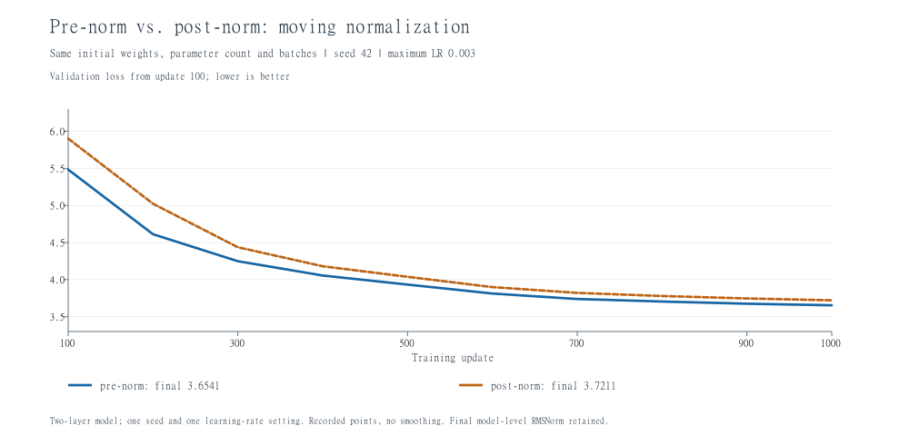

# 2026-10-29：pre-norm 与 post-norm

## 改变了什么

本次保留归一化，只调整 Transformer Block 内的计算顺序。Norm 指 RMSNorm；Attention 和 FFN 分别是原来的注意力模块和 SwiGLU。

原来的 pre-norm：

```python
z = x + attention(norm1(x))
y = z + ffn(norm2(z))
```

实验的 post-norm：

```python
z = norm1(x + attention(x))
y = norm2(z + ffn(z))
```

pre-norm 在更新分支的输入上归一化，残差通路仍直接携带原向量。post-norm 对原向量加更新后的整体做归一化。它不只是对同一个结果换个位置做处理：注意力和前馈网络接收到的输入也变了，因而产生的更新不同。

从反向传播角度看，pre-norm 的残差相加给梯度提供一条直接通路；post-norm 的相加结果后面还有归一化，经过这一部分的梯度也会经过归一化的导数。这有助于理解为什么位置可能影响深网络的优化，但本次 loss 曲线没有直接测量梯度传播机制。

## 实现和对照

- 新增 `train_post_norm.py`，其中 `PostNormBlock` 沿用原 Block 的 ln1、ln2、attn、ffn 对象，只替换 forward 的顺序。
- 创建完整原模型后转换为 post-norm；检查全部参数对象、参数名称、注册顺序、初值指纹保持一致。两组均有 1,362,240 个参数。
- 两层各两个 RMSNorm，加上模型输出层前的 ln_final，共五个。ln_final 保持原位置；RoPE、因果遮罩和 SwiGLU 均保留。
- 为复用现有训练流程，`train_norm_ablation.run_case` 增加可选的 `model_transform` 和 `case_name` 参数。未提供它们时，原先移除 RMSNorm 实验的行为和命名不变。核心模型文件没有修改。
- batch=4、context=64、1000 步，共 256,000 个目标 token；同样的初始参数 seed=42、1000 个训练批次和顺序、10 个固定验证批次（验证抽样 seed=12345）。
- AdamW betas=(0.9,0.999)、eps=1e-8、weight_decay=0.01，梯度裁剪阈值 1；最大学习率 0.003、最低 0.0003、预热 50 步、余弦下降至 1000 步；CPU 4 个线程。
- pre-norm 复用已核验的完整基线；post-norm 从相同初始参数重新训练，不从基线训练后的参数开始。

## 结果

| 版本 | 初始验证 loss | 最终验证 loss | 状态 |
| --- | ---: | ---: | --- |
| pre-norm | 9.2105 | 3.654119 | 复用完整基线 |
| post-norm | 9.2104 | 3.721088 | 完成 1000 步 |



图从第 100 步开始，完整 CSV 包含初始及首次更新点；记录点直线相连，没有平滑。当前训练设置下 pre-norm 最终验证 loss 低约 0.06697，两组都能完成训练。不能把 post-norm 的结果写成数值崩溃。

初始参数相同但初始 loss 可以不同，因为前向计算顺序已经改变。这次仅有两层、一个种子、一个学习率设置和较小的验证窗口集合；未分别调优 post-norm 学习率，也未做多种子重复，不能判断所有规模和设置下的优劣。该训练预算仍是学习用小实验，未达到讲义正式训练规模。

## 文件与验证

- 脚本：`E:\CS336\assignments\a1-basics\cs336_basics\train_post_norm.py`。
- 结果目录：`E:\CS336\assignments\a1-basics\cs336_basics\post_norm_runs\20261029_115746_861642_seed42`。
- 内含 `post_norm_summary.json`、两条 CSV 曲线和新增的 post-norm 存档；pre-norm 存档引用旧实验。
- 先运行两组各两步的流程检查，再正式训练 post-norm 1000 步。转换后参数名称和值保持一致，初始 logits 有实际变化且为有限数。
- 核对两条完整曲线的 12 个记录点、训练步数、最终 loss、参数量、初值指纹和实际批次指纹。
- 重新创建对应架构并载入两份模型/优化器存档，迭代数恢复为 1000，重算验证 loss 与记录一致，优化器状态条目数与参数对象数一致。
- 本次未重跑 A1 全套测试，也没有推送 GitHub。

恢复 post-norm 存档时，要先创建 TransformerLM，再调用 `make_post_norm(model)`，最后加载存档。两种版本参数名称相同，直接载入原 pre-norm 模型可能不报错，但执行的计算方式会不对。存档里的权重不会自动改变 forward 的代码。

下一步：SwiGLU 与普通 SiLU 前馈网络对比，并先匹配参数数量。

## 本次归档补充

[完整 CSV 曲线与汇总](experiments/2026-10-29/post-norm/README.md)已随源码同步；模型存档未上传。上述“未推送”描述保留为实验当天的历史状态。
