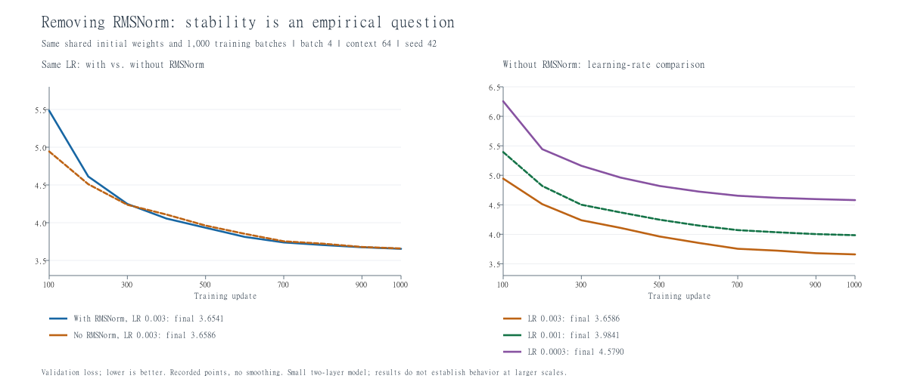

# 2026-10-29：移除 RMSNorm 的消融实验

## 目的和直觉

RMSNorm 将每个 token 的特征向量除以其均方根，再逐维乘可学习的缩放参数 g。它不做减均值操作，也不保证乘 g 后的均方根始终为 1。

忽略 eps、令 g 的每维都为 1 时，`[3,4]` 和 `[30,40]` 都变成约 `[0.849,1.131]`。这说明它能减弱向量整体幅度不同带来的影响；维度间的相对比例保留下来。

当前模型是 pre-norm：先归一化，再交给注意力或前馈网络计算更新，最后通过残差连接加回原向量。本实验把全部 RMSNorm 换成原样传递的 `nn.Identity()`：

```python
for block in model.layers:
    block.ln1 = nn.Identity()
    block.ln2 = nn.Identity()
model.ln_final = nn.Identity()
```

两层各有两个 RMSNorm，输出前还有一个，共移除五个。每个含 64 个 g 参数，参数量从 1,362,240 降为 1,361,920，差 320。原模型文件保持原实现，替换只在实验创建的实例内发生。

## 对照设计

- 沿用 batch=4、context=64、1000 次更新，共 256,000 个目标 token。此处沿用原基线，是为了直接比较归一化变化；不把批次大小同时改为上个实验表现较好的 2。
- 词表 10,000、维度 64、2 层、4 个头、SwiGLU 中间维度 128、保留 RoPE 和因果遮罩。
- 每组先用 seed=42 创建完整模型，再移除归一化，确保其余参数初值一致。对共同参数的名称和内容计算 SHA256；归一化的 g 排除在共同参数指纹之外。
- 同样的 1000 个训练批次及顺序；同样的固定 10 个验证批次，验证抽样 seed=12345。
- AdamW betas=(0.9,0.999)、eps=1e-8、weight_decay=0.01；梯度裁剪阈值 1。仍保留梯度裁剪，不代表关闭裁剪时也会得到相同的稳定性。
- 学习率预热 50 步、余弦下降至第 1000 步；最低学习率都是该组最大学习率的 0.1 倍。降低的是整条学习率曲线的尺度。
- 使用核验配置、初始参数、批次顺序、初始验证 loss 均匹配的有归一化基线。复用已有完整曲线和存档；新增三组无归一化训练。

## 结果

| RMSNorm | 最大学习率 | 最低学习率 | 最终验证 loss | 状态 |
| --- | ---: | ---: | ---: | --- |
| 保留 | 0.003 | 0.0003 | 3.654119 | 复用完整基线 |
| 移除 | 0.003 | 0.0003 | 3.658617 | 完成 1000 步 |
| 移除 | 0.001 | 0.0001 | 3.984097 | 完成 1000 步 |
| 移除 | 0.0003 | 0.00003 | 4.579028 | 完成 1000 步 |



左图固定学习率 0.003，比较保留和移除；右图只比较移除后的三个学习率。为显示训练中的差别，图从第 100 步开始，初始和首次更新点保留在 CSV 中。各记录点直线连接，无平滑。

当前条件下，移除 RMSNorm 后仍能训练，0.003 的最终验证 loss 与基线仅差约 +0.00450。它在前期更低，到后期两者接近；没有观察到非有限训练 loss、验证 loss 或梯度平方和。不能为了符合“归一化重要”的直觉，把这个结果写成训练崩溃。

降低学习率没有在本次 1000 步预算下带来更低的最终验证 loss。候选中无归一化版本最好的仍是 0.003；这不是全局最优学习率的证明。

模型只有两层，训练预算小，且只有一个种子和固定的一小组验证窗口。差 0.00450 不能据此声称存在可靠的泛化优势，也不能推断大模型、深网络或其他初始化下 RMSNorm 可以省略。本实验未直接测量激活尺度，不能从 loss 曲线单独证明其内部机制。

## 文件与复现

- 实验脚本：`E:\CS336\assignments\a1-basics\cs336_basics\train_norm_ablation.py`。在 PyCharm 直接运行会建立新的结果目录，不覆盖既有结果。
- 结果目录：`E:\CS336\assignments\a1-basics\cs336_basics\norm_ablation_runs\20261029_114740_004675_seed42`。
- 内含汇总 `norm_ablation_summary.json`、四条 CSV 曲线和三个新增无归一化存档；有归一化存档引用旧实验。
- 加载无归一化存档时，需要先创建 TransformerLM 并调用该脚本的 `remove_rmsnorm(model)`，再恢复参数和优化器。直接用完整归一化模型加载会出现参数名称不匹配。

## 验证范围

先用每组两步的 `--smoke` 检查流程；正式三组均完成 1000 步。核对四条曲线、共享初值指纹、实际批次指纹、步数、最终指标、320 个参数差值与存档存在。额外重新载入四份完整存档，恢复模型和优化器，重算固定验证集 loss 与记录一致。

没有修改核心模型、优化器和归一化文件，没有重跑 A1 全套测试；没有推送 GitHub。当前实验用于理解和对照，未达到讲义正式训练预算。

下一步：比较归一化放在残差相加前（pre-norm）和相加后（post-norm）的差别。

## 本次归档补充

[完整 CSV 曲线与汇总](experiments/2026-10-29/rmsnorm/README.md)已随源码同步；模型存档未上传。上述“未推送”描述保留为实验当天的历史状态。
