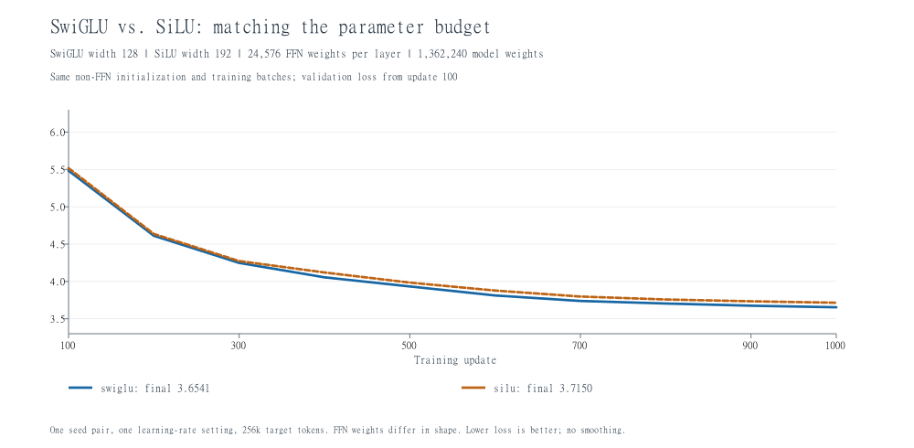

# 2026-10-29：SwiGLU 与普通 SiLU 前馈网络

## 门控怎样工作

普通 SiLU 前馈网络先投影、经过非线性激活，再投影回来：

```python
output = w2(silu(w1(x)))
```

SwiGLU 则有两条输入支路，相乘后再投影回来：

```python
gate = silu(w1(x))
value = w3(x)
output = w2(gate * value)
```

这里的乘法是逐元素相乘。可把 value 理解为内容，gate 理解为根据当前输入生成的逐维调节系数。例如 `[2,5]` 与系数 `[0.1,2]` 相乘得到 `[0.2,10]`。SiLU 生成的 gate 可以为负，也可以大于 1，不是概率。

前馈网络逐个处理 token 的特征向量；跨 token 的交互仍由注意力模块承担。

## 为什么普通 SiLU 的宽度设为 192

当前模型维度为 64，SwiGLU 中间维度为 128，使用无偏置 Linear：

| 前馈结构 | 权重矩阵形状（输出维度 × 输入维度） | 参数量 |
| --- | --- | ---: |
| SwiGLU，宽 128 | w1:128×64、w3:128×64、w2:64×128 | 24,576 |
| SiLU，宽 192 | w1:192×64、w2:64×192 | 24,576 |

即 `3 × 64 × 128 = 2 × 64 × 192`。两种模型总参数量都为 1,362,240。

讲义的普通 SiLU 方案写作 d_ff=4×d_model，用于匹配其默认 SwiGLU 的宽度设置。我们的既有小实验基线显式用了 SwiGLU d_ff=128；如果机械使用 4×64=256，SiLU 就有更多参数。因此本次选 192 来匹配实际基线。这是当前小配置的配平实验，不能写成完全复现讲义默认配置。

配平的是参数数量，不是所有计算和内存细节；激活、逐元素乘法和中间张量仍然不同。

## 对照设置与初值

- 保留 pre-norm、全部 RMSNorm、RoPE、因果遮罩；只替换每层的前馈网络。
- 词表 10,000、context=64、d_model=64、两层、四个注意力头。
- batch=4、1000 次更新，共 256,000 个目标 token；同样的 1000 个训练批次和顺序；相同的 10 个固定验证批次，验证抽样 seed=12345。
- 模型先用 seed=42 创建；替代 SiLU 前馈权重单独使用 seed=4242 初始化。使用原自定义 Linear 的截断正态规则，std=sqrt(2/(fan_in+fan_out))，截断到 ±3std。
- 前馈网络之外的参数，包括全部归一化权重，初值和对象保持一致，并通过名称与内容指纹核对。前馈网络的权重形状不同，不能逐个配对；两种完整模型的初值指纹不同。
- AdamW betas=(0.9,0.999)、eps=1e-8、weight_decay=0.01，梯度裁剪阈值 1；最大学习率 0.003、最低 0.0003、预热 50 步、余弦下降至 1000 步。
- CPU、4 个计算线程。SwiGLU 复用经配置、初始参数、数据顺序和初始验证 loss 核验的已有完整基线；普通 SiLU 新训练 1000 步。

## 结果

| 前馈网络 | 中间维度 | 模型参数量 | 最终验证 loss |
| --- | ---: | ---: | ---: |
| SwiGLU | 128 | 1,362,240 | 3.654119 |
| SiLU | 192 | 1,362,240 | 3.714955 |



当前配置中 SwiGLU 最终验证 loss 低约 0.06084。两组均完成 1000 步，没有出现记录到的非有限训练 loss、验证 loss 或梯度平方和。图从第 100 步开始，原 CSV 保留初始和首次更新点；记录点直线相连，无平滑。

本次只比较一组初始化和同一学习率，前馈初值无法逐项对应，尚未做多种子重复或分别调整学习率。因此可以说“当前配平实验中 SwiGLU 更好”，不能把全部差异确定归因于门控，也不能推广为所有配置都更好。预算仍是学习用小实验，未达到讲义正式训练规模。

## 文件与验证

- 新脚本：`E:\CS336\assignments\a1-basics\cs336_basics\train_silu_ablation.py`，包含 `SiLUFFN`、`make_silu` 和实验入口。
- 为复用已有训练流程，`train_norm_ablation.run_case` 新增可选的 `shared_hash_fn`，用来核对本次共同拥有的非前馈网络参数；默认仍是原来的归一化实验指纹。增加变换后的实际初值指纹字段，原有调用方式和默认行为保留。
- 核心 Transformer、SwiGLU、优化器文件没有修改。
- 正式结果：`E:\CS336\assignments\a1-basics\cs336_basics\silu_ablation_runs\20261029_121123_804504_seed42`，内含汇总、两条曲线和新增的 SiLU 存档；SwiGLU 存档引用已有基线。
- 先完成两组各两步的流程检查，再正式训练 SiLU 1000 步。核对每层及模型总参数量、非前馈共同初值、实际 SiLU 初值、批次顺序指纹、两条曲线的 12 个记录点与最终指标。
- 重新创建对应架构并载入两份模型和优化器存档，迭代数恢复为 1000，重算验证 loss 与记录一致；SiLU 权重形状、每层参数量、优化器状态条目数均核对通过。
- 本次没有重跑 A1 全套测试，没有推送 GitHub。

恢复 SiLU 存档时，先创建原 TransformerLM，再调用 `make_silu(model)`，最后加载模型与优化器参数；原 SwiGLU 模型的前馈权重形状不兼容。

下一步转向参数量、FLOPs 和训练内存核算，将这些已运行的小实验与课程的资源预算联系起来。

## 本次归档补充

[完整 CSV 曲线与汇总](experiments/2026-10-29/swiglu-silu/README.md)已随源码同步；模型存档未上传。上述“未推送”描述保留为实验当天的历史状态。
