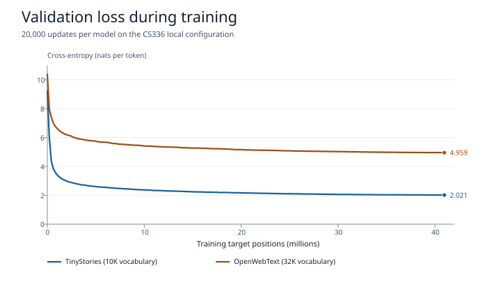
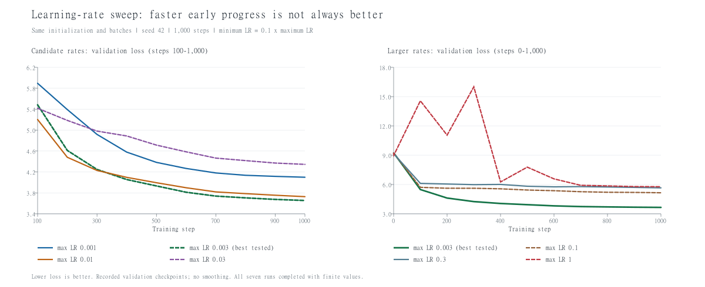
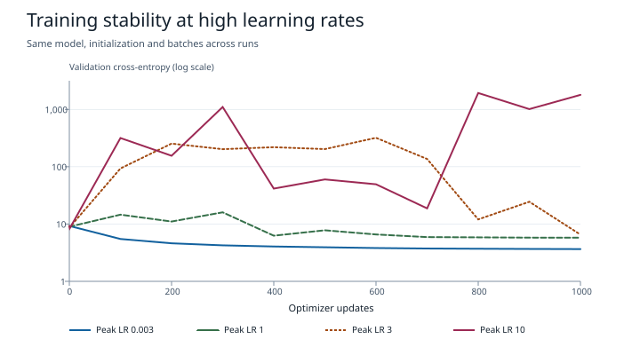
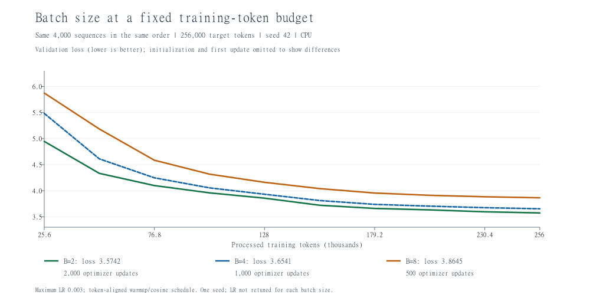
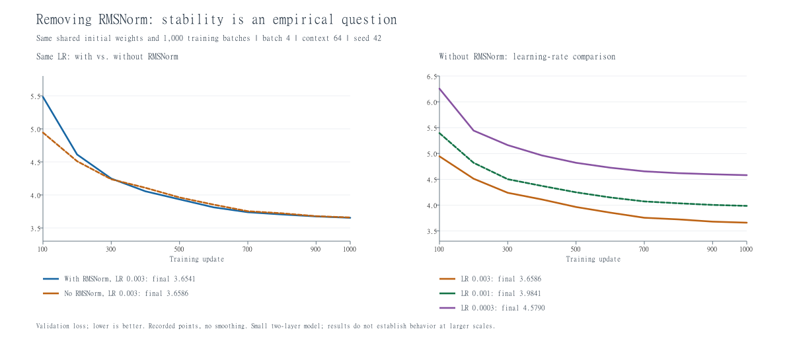
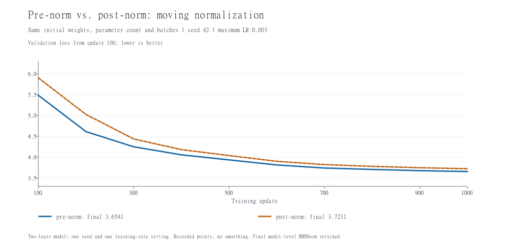
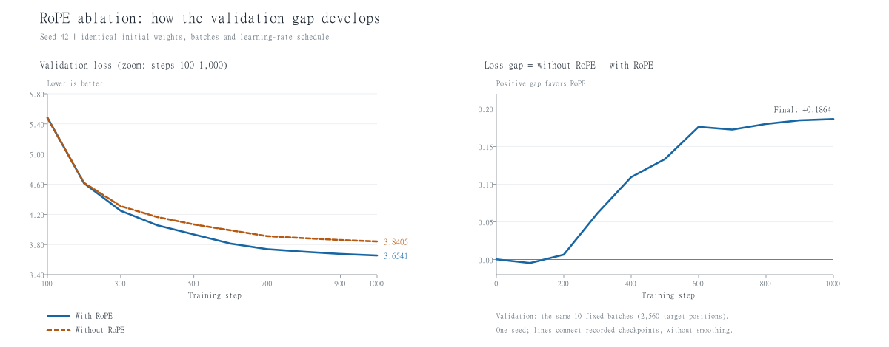
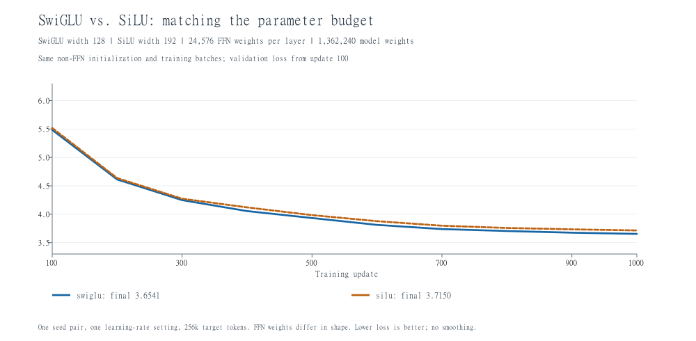

# CS336 A1｜分词、模型训练与资源核算

两个本地小模型各更新 **20,000 步**，各处理 **4,096 万个训练目标位置**。TinyStories 的全量验证交叉熵为 **1.9715**，OpenWebText 为 **4.9895**。这两项分数分别描述模型对各自验证集的预测表现。

本文按本地 A1 讲义 Version 26.0.3 整理。训练曲线和分析使用已有运行，详细配置、原始记录和复现入口随学习仓库归档。

## Unicode 与 UTF-8

`chr(0)` 返回码位 U+0000，即 NUL。`repr(chr(0))` 显示为 `'\x00'`，直接打印通常没有可见字形。在 Python 字符串 `"A" + chr(0) + "B"` 中它是一个真实字符，长度为 3，后面的 `B` 仍会保留。

UTF-8 与 ASCII 兼容，常见英文和代码中的 ASCII 字符各占一字节，适合这次以英文为主的训练材料。常见汉字在 UTF-8 中通常占三字节，在 UTF-16 中通常占两字节。以“你”为例，UTF-8 编码为 `e4 bd a0`，三个字节必须合在一起解码。`ff ff` 会触发严格 UTF-8 解码错误，因为 `ff` 不属于合法 UTF-8 字节。BPE 解码也应先拼接各 token 对应的字节，再整体转回文本。

## 分词器训练与编码

### 完整语料上的 BPE

每套词表从 256 个基础字节和一个文档结束标记 `<|endoftext|>` 开始。预分词先按正则划分片段，再按出现频率合并片段内的相邻 token。训练结束后保存词表和合并顺序，用同一套产物编码对应的训练集和验证集。

| 实测项目 | TinyStories | OpenWebText |
| --- | ---: | ---: |
| 词表大小 / 合并轮数 | 10,000 / 9,743 | 32,000 / 31,743 |
| CPU 时间 | 841.46 秒 | 预分词 2,824.86 秒，读频率表至保存词表 772.22 秒 |
| Windows 进程工作集峰值 | 97.57 MiB | 预分词 1.25 GiB，合并阶段 5.34 GiB |
| 最长普通 token | 带前导空格的 ` responsibility`，15 字节 | `ÃÂ` 重复 16 次，64 字节 |

TinyStories 的计时覆盖 `train_bpe` 内的预分词与合并，词表写盘在计时之外。OpenWebText 两个阶段分开运行，内存值也分别记录。前者最长 token 是带空格的完整词，后者的重复字节模式说明 BPE 会把常见的相邻字节合到一起，即使合出的内容不像自然语言里的词。仅凭词表无法确定重复串在原文中的来源。

### TinyStories 完整训练集的性能分析

用相同 BPE 源码和完整的 2,227,753,162 字节训练文件单独补跑一次 profile。带 profiler 的总时间为 **1,231.85 秒（20 分 32 秒）**，进程工作集峰值约 **101.12 MiB**。新词表的全部 ID 映射和全部 9,743 条有序合并规则与普通训练逐项一致。

| 阶段 | 经过时间 | 占本次总时间 |
| --- | ---: | ---: |
| 预分词及统计片段频率 | **988.76 秒** | **80.27%** |
| 将片段转为字节并建立初始索引和频率表 | 0.81 秒 | 0.07% |
| 逐轮扫描候选表，选最高频 token 对 | 229.80 秒 | 18.65% |
| 应用合并、更新命中片段及计数 | 12.47 秒 | 1.01% |

全量运行的大头在预分词。在合并阶段内部，约 95% 的时间仍花在选最高频对。倒排索引让更新阶段只访问命中的片段，选对仍要扫描候选表。此前验证集调试记录中，`max` 累计约 60.16 秒，预分词约 12.02 秒。换到完整训练集后，预分词要统计每一次出现的片段，合并阶段则主要处理不同片段及其候选对，两部分的耗时随语料规模变化的方式不同。

表中比例由独立的阶段计时器计算，包含 profiler 开销。原始 cProfile 表捕获了进度线程的等待，部分累计时间互相重叠，因此保留原表供排查，阶段比例以经过时间为准。普通训练的 841.46 秒另列，两次运行的差值不能全归因于某一个函数。

[全量 profile 的方法、数据与复现命令](experiments/2026-11-07/tinystories-bpe-profile/README.md) · [TinyStories 完整 BPE 实测](2026-11-01-A1-TINYSTORIES-FULL-BPE.md) · [TinyStories 验证集 profile](2026-11-01-A1-FULL-TINYSTORIES-PREPARATION.md) · [OpenWebText 全量记录](2026-11-07-A1-OPENWEBTEXT-FULL.md)

### 词表对照、吞吐与数组存储

从两套验证材料中各取固定的 10 篇文档，再分别使用两个词表。四组都准确还原了原文。表中压缩率为该组总 UTF-8 字节数除以总 token 数。

| 原文样本 | TinyStories 10K：token 数 / 字节每 token | OpenWebText 32K：token 数 / 字节每 token |
| --- | ---: | ---: |
| TinyStories，8,457 字节 | 2,084 / 4.0581 | 2,145 / 3.9427 |
| OpenWebText，32,294 字节 | 10,134 / 3.1867 | 7,582 / 4.2593 |

网页词表让这一组网页少用了 2,552 个 token，约少 25.2%。在故事样本上，词表较小的 TinyStories 反而少用了 61 个 token。这组对照同时改变了训练语料和词表容量，观察结果包含两者的影响。

在约 1 MiB 的完整网页文档前缀上，纯编码计时三次取中位数。自写 Python 版约 **0.128 MB/s**，使用相同词表和规则的加速版约 **5.33 MB/s**，输出 ID 逐项一致。用 `825 × 10⁹ 字节 / 实测吞吐` 线性外推，两者分别约需 **1,795 小时**和 **43 小时**。估计基于同一个单进程样本，计时范围仅覆盖编码。

| 完整编码结果 | 训练集 token 数 | 验证集 token 数 |
| --- | ---: | ---: |
| TinyStories | 541,229,347 | 5,465,883 |
| OpenWebText | 2,727,120,452 | 66,401,098 |

最大 token ID 分别为 9,999 和 31,999，都在 `uint16` 的 0–65,535 范围内，因此磁盘上每个 ID 用 2 字节即可。四份数组均完成字节级还原核验。OpenWebText 的训练数组超过了有符号 32 位下标范围，Windows 上用 64 位整数取样可以访问数组尾部。词表 ID 的存储类型与数组下标的类型分别取决于词表大小和数据长度。

[跨域对照与吞吐原始数据](experiments/2026-11-07/owt/tokenizer-comparison.json) · [TinyStories 编码结果](experiments/2026-11-01/tinystories-full-encoding/encoding-result.json) · [OpenWebText 训练集编码](experiments/2026-11-07/owt/encoded-train.json) · [OpenWebText 验证集编码](experiments/2026-11-07/owt/encoded-valid.json)

## 语言模型实验设置

两次运行共用 4 层 pre-norm Transformer 主干，模型宽度 128、4 个注意力头、FFN 宽度 384，使用 RoPE 和 SwiGLU。每步取 8 个长度为 256 的窗口，用自写 AdamW 在 FP32 下训练。学习率前 200 步升至 0.001，再按余弦下降至 0.0001。两次运行均用 seed 42，验证采样种子为 12345。

| 项目 | TinyStories | OpenWebText |
| --- | ---: | ---: |
| 在各自完整训练集上学习的 BPE 词表 | 10,000 | 32,000 |
| 训练数组长度 | 541,229,347 | 2,727,120,452 |
| 模型参数量 | 3,413,120 | 9,045,120 |
| 训练设备 | CPU 前 100 步，随后 RTX 3050 Laptop | RTX 3050 Laptop |
| 日志记录的活跃训练时间 | 25 分 10 秒 | 32 分 49 秒 |

窗口在训练数组上随机抽取，可以重复或重叠。4,096 万计的是模型实际做过的预测，两个训练集均大于这个预算。两套词表大小不同，输入嵌入和输出层的权重独立，词表每多一项就多出 256 个参数。因此相同的步数和目标位置数对应不同的每步计算量。

[TinyStories 配置](experiments/2026-11-01/full-training-20k/config.json) · [OpenWebText 配置](experiments/2026-11-07/owt/training-config.json)

## 学习曲线与全量验证



图中每条线对应训练日志里的 **202 个验证点**，使用该次运行的固定 10 批验证窗口，每次给 20,480 个位置打分。到第 1,000 步，TinyStories 的 loss 从 9.2332 降到 2.9713，OpenWebText 从 10.3782 降到 6.1876。第 10,000 到第 20,000 步，两者又分别下降约 0.14 和 0.19。末段还在下降，但每增加同样数量的训练 token，观察到的改善已经小得多。

| 第 20,000 步存档 | TinyStories | OpenWebText |
| --- | ---: | ---: |
| 固定批次平均交叉熵 | 2.0210 | 4.9594 |
| 全量验证预测位置 | 5,465,882 | 66,401,097 |
| 全量平均交叉熵 | **1.9715** | **4.9895** |
| 全量困惑度 `exp(loss)` | 7.18 | 146.86 |

全量评估把验证数组切成连续的 256-token 输入窗口，目标向右移一个位置。每个窗口重新积累上下文。从整个数组的第二个 token 起，每个目标位置评分一次，包括最后一个较短的窗口。固定批次和全量评估的窗口起点不同，表里的差值同时受位置覆盖和可用上下文影响。

交叉熵给的是每个真实 token 的平均失分 `−ln p(真实 token | 窗口内前文)`。对比两条曲线的起点时，均匀猜测的 loss 本来就随词表变化，10K 和 32K 分别约为 `ln(10000) = 9.2103` 和 `ln(32000) = 10.3735`。验证文本的内容也不同，而且两套词表切出的预测单位不同。举例说，带前导空格的 ` legislation` 在 TinyStories 词表里需要预测四次，在 OpenWebText 词表里只需预测一次。这些差异限制了用两个每 token 分数来比较生成质量。

[TinyStories 曲线 CSV](experiments/2026-11-01/full-training-20k/metrics.csv) · [OpenWebText 曲线 CSV](experiments/2026-11-07/owt/training-metrics.csv) · [绘图脚本](experiments/2026-11-07/owt/plot_learning_curves.py) · [TinyStories 全量指标](experiments/2026-11-04/full-validation.json) · [OpenWebText 全量指标](experiments/2026-11-07/owt/full-validation.json) · [词表对照](experiments/2026-11-07/owt/tokenizer-comparison.json)

## 生成文本

两次生成均用第 20,000 步的存档，temperature 0.8、top-p 0.9、seed 42。上限 256 个新 token，遇到 EOS 即结束。各自用贴合训练语料的提示词。

| 模型 | 提示词 | 新 token 数 | 停止原因 |
| --- | --- | ---: | --- |
| TinyStories | `Once upon a time` | 200（含 EOS） | 遇到结束标记 |
| OpenWebText | `The city council announced on Tuesday that` | 256 | 达到生成上限 |

**TinyStories**

> Once upon a time, there was a boy named Tim. Tim loved to play outside with his friends. One day, while playing, they saw a big tree. The tree had a pretty, shiny silver arrow.

Tim、朋友和银色的箭贯穿全文，故事有开头也有结尾。中间多次重复玩箭，结尾突然说箭变得不可怕，前文没有交代这种转变。

**OpenWebText**

> “We need to grow water,” he said. “We’re just as happy to work with the city.”

模型生成了报道常见的日期、引语和段落结构，但从市议会转到银行、慈善组织和枪击事件时，缺少能串起这些事件的叙述。一个可能的原因是网页语料涵盖更多主题和文体，有限的训练预算要分给更多种写法。这里各观察一段输出，提示词、词表和训练语料也不同，因此只比较样例里能直接看到的现象。

[TinyStories 全文](experiments/2026-11-01/full-training-20k/sample.md) · [OpenWebText 全文](experiments/2026-11-07/owt/sample.txt) · [TinyStories 生成参数](experiments/2026-11-01/full-training-20k/generation.json) · [OpenWebText 生成参数](experiments/2026-11-07/owt/generation.json)

## SGD 学习率小实验

用同一个 `10 × 10` FP32 参数张量起点，目标是最小化 100 个参数的平方均值。各组做 10 次 SGD 更新，第 `t` 次更新的有效学习率为 `lr / sqrt(t+1)`，`t` 从 0 开始。这里的学习率属于单独的平方损失题。

| 学习率 | 初始 loss | 第 1 次更新后 | 第 10 次更新后 |
| ---: | ---: | ---: | ---: |
| 1 | 24.1693 | 23.2122 | 19.7481 |
| 10 | 24.1693 | 15.4683 | 2.85035 |
| 100 | 24.1693 | 24.1693 | 3.11013e-24 |
| 1000 | 24.1693 | 8725.1 | 6.35108e+19 |

每次更新相当于把每个参数乘以 `1 - lr / (50 sqrt(t+1))`。学习率 100 在第一步将权重翻转符号，平方损失几乎不变；第四步的乘数在精确算术中为零，FP32 中留下微小残差。学习率 1000 的前十次乘数绝对值均大于 1，因此 loss 持续上升。

[Unicode 与 SGD 完整逐题记录](2026-11-01-A1-UNICODE-AND-SGD.md)

## 学习率扫描与稳定性

从这里起使用 5 MiB TinyStories 的两层模型，宽度 64、4 个注意力头、上下文 64，验证使用固定的 10 批数据。学习率和结构对照的每次运行用 batch 4 做 1,000 次更新，共处理 256,000 个目标位置。批量大小实验保持同样的 token 预算，更新次数随 batch 变化。

固定 seed 42、初始权重和训练批次顺序。学习率在前 50 步预热，再余弦衰减到峰值的十分之一。先试 0.001、0.003、0.01 和 0.03，随后逐级放大峰值，观察验证 loss 何时开始大幅波动。

| 峰值学习率 | 最终验证 loss |
| ---: | ---: |
| 0.001 | 4.0989 |
| **0.003** | **3.6541** |
| 0.01 | 3.7276 |
| 0.03 | 4.3451 |
| 0.1 | 5.1529 |
| 0.3 | 5.6569 |
| 1 | 5.7733 |
| 3 | 6.5355 |
| 10 | 1795.1508 |



0.01 前约 300 步下降较快，到第 400 步左右被 0.003 反超。0.003 在这组候选里最终分数最低。这个选择依据的是固定预算后的验证表现，训练初期的下降速度只能说明早期的进展。



高学习率图用对数刻度容纳几个数量级的 loss。峰值为 3 时，第 600 步的验证 loss 约 319.60，调度后期部分恢复到 6.54。峰值为 10 时，第 800 步升至约 1,934.64，结束仍约 1,795.15。这是按 loss 轨迹判断的持续失稳，记录里的 loss 和梯度平方和均有限。当前采样点只定位到一次可恢复的大幅波动和一次持续失稳，精确阈值仍未知。就本次扫描而言，表现最好的 0.003 距离观测到的严重失稳还很远。

[原始扫描记录](2026-10-27-A1-TRAINING-GENERATION-AND-EXPERIMENTS.md) · [高学习率补测数据](experiments/2026-11-04/lr-stability/summary.json) · [高学习率绘图脚本](experiments/2026-11-04/lr-stability/plot_stability.py)

## 固定 token 预算下的批量大小

先抽取同样的 4,000 个长度为 64 的训练窗口，再按相同顺序每 2、4 或 8 段分组。各组均处理 256,000 个目标位置，使用相同的初始参数、固定验证批次和按 token 进度定义的学习率曲线。峰值学习率均为 0.003。

| Batch size | 更新次数 | 最终验证 loss | CPU 训练计算耗时 |
| ---: | ---: | ---: | ---: |
| 2 | 2,000 | **3.5742** | 59.70 秒 |
| 4 | 1,000 | 3.6541 | 42.74 秒 |
| 8 | 500 | 3.8645 | **33.82 秒** |



这一轮 batch 2 的 loss 最低，batch 8 用时最短。拿同样 8 段文本来说，batch 2 会更新 4 次，后面的文本会看到已经更新过的权重。batch 8 先把 8 段的梯度合起来，再更新一次。这样一来，更新次数和 AdamW 状态的演变都会变。结果来自一次 CPU 运行，三个 batch 共用一套学习率调度，耗时不含验证与存档。讲义要求的更宽批量范围和分别调参仍待覆盖。

[对照配置与逐点数据](2026-10-29-A1-BATCH-SIZE.md)

## 四组结构消融

每组沿用两层模型和 256,000 个目标位置的预算，同一对照里的基线与改动版使用相同的训练和验证批次。RoPE 对照分别用 seed 42、43、44 做配对，三个种子的训练抽样顺序随种子变化，验证批次固定。其余三项各做一组初始化。表中差值为改动后的 loss 减基线 loss，正值表示在该实验里验证表现下降。

| 改动 | 基线 loss | 改动后 loss | 差值 |
| --- | ---: | ---: | ---: |
| 移除 RMSNorm，峰值学习率仍为 0.003 | 3.6541 | 3.6586 | +0.0045 |
| Pre-norm 改为 post-norm | 3.6541 | 3.7211 | +0.0670 |
| 去掉 RoPE，三次配对的均值 | 3.6661 | 3.8390 | +0.1729 |
| SwiGLU 改为等参数量的 SiLU 前馈 | 3.6541 | 3.7150 | +0.0608 |

### 移除 RMSNorm

移除块内和输出头前的 RMSNorm 后，峰值为 0.003 的一组仍完成训练，最终只比基线高 0.0045。降到 0.001 和 0.0003 后，最终 loss 分别为 3.9841 和 4.5790。对这个两层模型，降低学习率没有在同样步数内改善结果，0.0045 的差也只来自一个种子。



[RMSNorm 实验配置与逐点数据](2026-10-29-A1-RMSNORM-ABLATION.md)

### Pre-norm 和 post-norm

Pre-norm 先归一化子层输入，post-norm 在残差相加后归一化。两组从相同权重开始，都完成训练。仅改变前向顺序就能改变初始 loss，最终 post-norm 高约 0.0670。比较用的是同一学习率，post-norm 尚未单独调参。



[归一化位置实验配置与逐点数据](2026-10-29-A1-PRE-POST-NORM.md)

### RoPE 和 NoPE

关闭 RoPE 时保留因果遮罩，同一种子下的权重初值和训练批次一致。三个种子的 loss 差值依次为 +0.1864、+0.1377、+0.1947，平均 +0.1729，样本标准差 0.0308。三次方向一致。下图展示 seed 42，差距主要在训练过程中拉开。



[三种子配对结果](experiments/2026-10-27/rope/multi_seed_results.csv)

### SwiGLU 和 SiLU

SwiGLU 用三个权重矩阵，普通 SiLU 前馈用两个。把中间宽度从 128 调到 192，可使每层前馈参数量都为 24,576，整模参数量都为 1,362,240。这次 SwiGLU 的最终 loss 低约 0.0608。前馈权重的形状不同，两组各自初始化，参数量配平后仍存在不同的运算和中间张量。



[前馈结构实验配置与逐点数据](2026-10-29-A1-SWIGLU-SILU.md)

## Transformer 与 AdamW 资源核算

### 参数量和前向 FLOPs

设 `V` 为词表大小，`T` 为上下文长度，`L` 为层数，`d` 为模型宽度，`H` 为头数，`f` 为 SwiGLU 中间宽度。使用 A1 的无偏置结构，输入嵌入与输出投影各有一套权重。按一次乘法和一次加法共计 2 FLOPs，对一条长度为 `T` 的序列记主要稠密矩阵乘法。

```text
P = 2Vd + L(4d² + 3df + 2d) + d
F = L(8Td² + 4T²d + 6Tdf) + 2TdV
```

参数公式中的块内四组注意力投影、三组前馈矩阵和两个 RMSNorm 分别贡献 `4d²`、`3df`、`2d`。最后的 `d` 来自模型输出前的 RMSNorm。对题设 XL，`V=50,257，T=1,024，L=48，d=1,600，H=25，f=4,288`，得到 **1,640,452,800** 个参数，FP32 权重需要 **6.562 GB**（6.111 GiB）。

| 前向计算项 | 形状与重复方式 | XL 的 FLOPs |
| --- | --- | ---: |
| Q、K、V 和注意力输出投影 | `T×d` 乘 `d×d`，每层四次 | 1,006,632,960,000 |
| QK 打分和 AV 加权 | 每头 `T×(d/H)` 乘 `(d/H)×T`，再用 `T×T` 乘 `T×(d/H)` | 322,122,547,200 |
| SwiGLU | 每层两次 `T×d` 乘 `d×f`，一次 `T×f` 乘 `f×d` | 2,023,332,249,600 |
| 输出词表投影 | `T×d` 乘 `d×V` | 164,682,137,600 |
| **合计** | 每条 1,024-token 序列的一次前向 | **3,516,769,894,400** |

| 尺寸或上下文 | 前向 TFLOPs | 注意力投影 | QK 与 AV | SwiGLU | 词表投影 |
| --- | ---: | ---: | ---: | ---: | ---: |
| Small，T=1,024 | 0.2916 | 19.88% | 13.25% | 39.76% | 27.10% |
| Medium，T=1,024 | 0.8302 | 24.83% | 12.42% | 50.05% | 12.70% |
| Large，T=1,024 | 1.7867 | 27.04% | 10.82% | 54.76% | 7.37% |
| XL，T=1,024 | 3.5168 | 28.62% | 9.16% | 57.53% | 4.68% |
| XL，T=16,384 | 133.5777 | 12.06% | 61.73% | 24.24% | 1.97% |

前三个尺寸的 `f` 按现有实现向上取到 64 的倍数。固定上下文时，宽度和层数增加，块内投影占比上升。对 XL 把上下文放大 16 倍，投影 FLOPs 放大 16 倍，QK 与 AV 放大 256 倍，总量约为原来的 **37.98 倍**。这个口径按稠密注意力的完整矩阵记账，归一化、softmax、RoPE、激活等逐元素计算在表外。

[参数和前向逐项推导](2026-10-29-A1-TRANSFORMER-ACCOUNTING.md) · [精确数值](experiments/2026-10-29/transformer-accounting.json)

### 训练状态、激活与时间估算

FP32 下，参数和梯度各需 `4P` 字节，AdamW 的一阶矩和二阶矩合计 `8P` 字节。设 `B` 为一次前向实际送入的序列数，按题设对各主要算子输出累计一份，另计一份交叉熵中间张量。

```text
激活字节 = 4BT[L(8d + 4f + 2HT) + d + 2V]
总记账字节 = 16P + 激活字节
```

在 AdamW 内存题的 `f=8d/3` 近似下，XL 的固定状态约为 **26.17 GB**，每条序列的激活约为 **16.36 GB**。按 `floor((80−26.17)/16.36)` 得到最大整数 batch **3**，三条约 75.24 GB，四条约 91.60 GB。公式累加选定输出的大小，实际训练峰值还取决于张量何时释放、是否共享存储，以及运行时工作区。这里给出的是题设的记账结果。

讲义伪代码的稳态 AdamW 更新约 **14P FLOPs**，其中权重衰减、一阶矩、二阶矩和参数更新分别约为每参数 2、3、4、5 次运算。本地实现分开做两次偏差修正并用乘式衰减，按同一计数规则约 **15P**。更新在有效 batch 的梯度汇总后执行一次。

训练时间题沿用整数 `f=4,288` 的 XL 前向 FLOPs，按反向为前向的两倍计算。在有效 batch 1,024、400,000 步、题设峰值 495 TFLOP/s 和 50% MFU 下，`3 × 3.5167698944 × 10¹² × 1,024 × 400,000 / (495 × 10¹² × 0.5)` 约为 **4,850 小时（202 天）**。若整题统一使用连续宽度 `f=8d/3`，则约为 **4,836 小时**。这里的有效 batch 是每次优化器更新汇总的序列数，训练时可由多次微批计算累积而成。

[激活与显存逐项推导](2026-10-30-A1-ADAMW-MEMORY-ACCOUNTING.md) · [AdamW 运算与时间推导](2026-10-30-A1-ADAMW-COMPUTE-AND-TIME.md)

## 交付范围

这是 A1 的个人自学归档。TinyStories 全量 loss 低于讲义低资源提示里的 2.00 数值目标，使用的是本报告的模型尺寸和窗口评估口径。Linux 分词器内存限制、课程原尺寸实验、更宽的 batch 扫描、精确学习率稳定边界和排行榜仍未覆盖。

打包后解压 `code.zip`，用包内源码和已归档的接入函数重新运行现有 A1 测试集。Windows 上结果为 **46 项通过、2 项跳过**，耗时 17.11 秒。跳过的是依赖 `resource` 内存限制的两个分词器测试。

[Unicode 与 SGD 逐题记录](2026-11-01-A1-UNICODE-AND-SGD.md) · [A1 交付核对与原始清单](2026-10-30-A1-COMPLETION-AUDIT.md)
